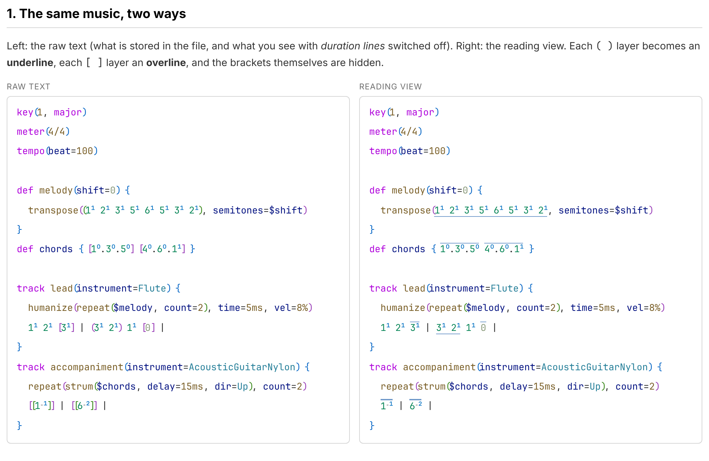
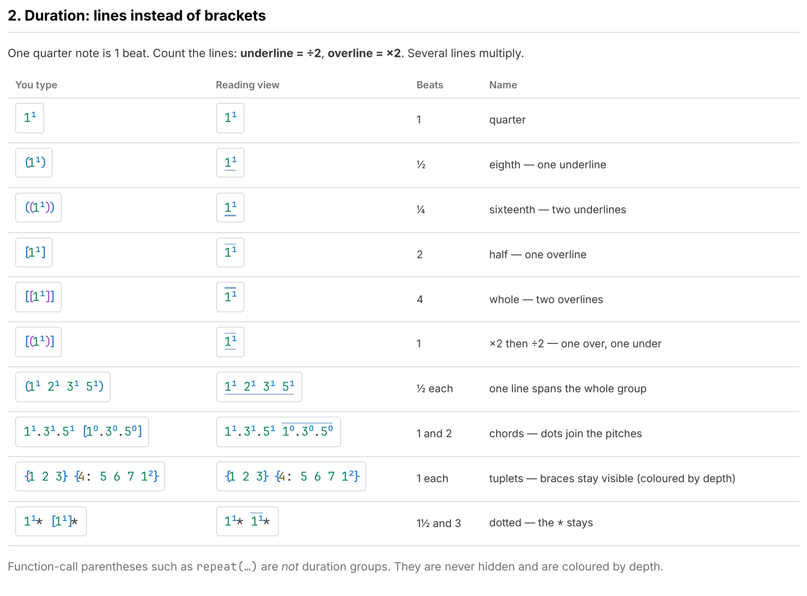
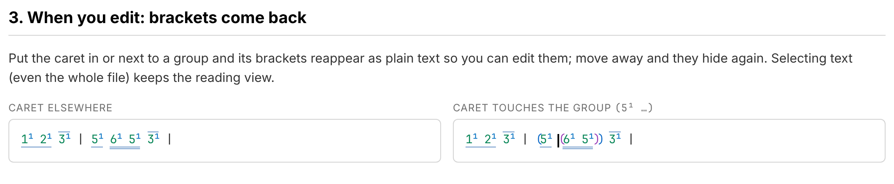
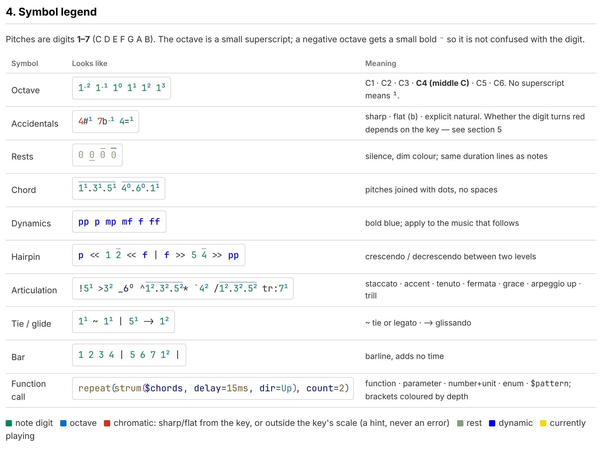
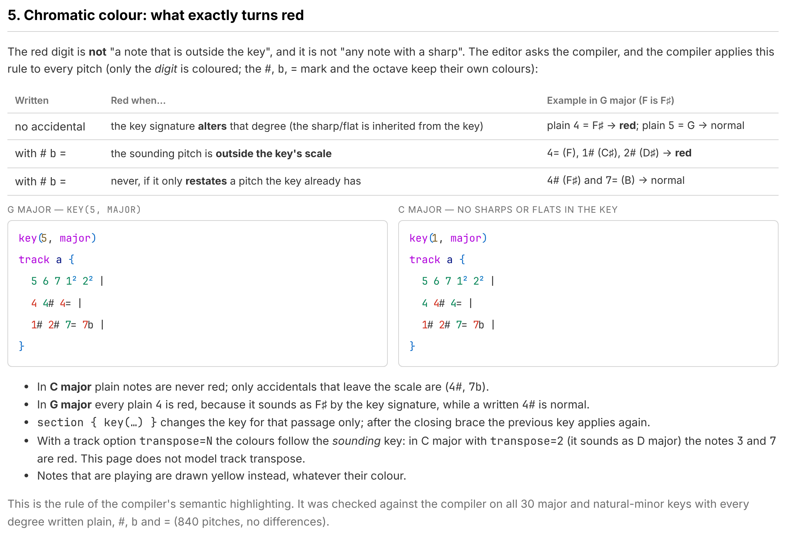

# Music DSL — writing guide

A practical, example-first guide to writing **Music DSL** (numeric notation 4.0): a plain-text language that compiles to notes (`.music`) plus a separate text format for mixing (`.mix`). This is a single self-contained document: read it top to bottom, or jump to a section from the table of contents.

```musicdsl
key(1, major)
meter(4/4)
tempo(beat=100)

def melody(shift=0) {
  transpose((1¹ 2¹ 3¹ 5¹ 6¹ 5¹ 3¹ 2¹), semitones=$shift)
}
def chords { [1⁰.3⁰.5⁰] [4⁰.6⁰.1¹] }

track lead(instrument=Flute) {
  humanize(repeat($melody, count=2), time=5ms, vel=8%)
}
track accompaniment(instrument=AcousticGuitarNylon) {
  repeat(strum($chords, delay=15ms, dir=Up), count=2)
}
```

- Notes are the **numbers 1–7** (C D E F G A B). The octave is a **superscript** (`1¹` = middle C).
- Durations are **wrappers**: `( )` halves, `[ ]` doubles, `*` dots. One quarter note = 1 beat.
- Composition lives in **`.music`**. Mixing (volume, pan, buses, sends, effects, automation, export) lives in **`.mix`**.
- 39 built-in functions (arpeggiators, groove, euclid, voice leading, humanize, …) work on notes before any audio exists.

## Contents

1. [Instructions for AI agents](#instructions-for-ai-agents)
2. [Reading view: how code looks in the editor](#reading-view-how-code-looks-in-the-editor)
3. [Cheat sheet](#cheat-sheet)
4. [1. Notation](#1-notation-how-to-write-notes)
5. [2. Score structure](#2-score-structure)
6. [3. Function reference](#3-function-reference)
7. [4. Sound sources](#4-sound-sources-instruments-soundfonts-and-vst3)
8. [5. The `.mix` format](#5-the-mix-format)
9. [6. CLI and workflow](#6-cli-and-workflow)
10. [Common mistakes](#common-mistakes)
11. [Worked examples](#worked-examples)
12. [Status of this guide](#status-of-this-guide)

---

## Instructions for AI agents

If a task asks you to write or edit `.music` or `.mix` files, follow this section. Do not rely on general music-notation knowledge: this language looks like numbered notation but has its own rules. To use this file in an agent workflow, copy it into a project as `CLAUDE.md` or `AGENTS.md` (or reference it from yours).

### Two file types, two jobs

| File | Contains | Never contains |
|---|---|---|
| `.music` | notes, `track`, `def`, `include`, `section`, `loop`, `key`/`meter`/`tempo`, `instrument`/`bank`, dynamics, performance functions | volume, pan, buses, sends, effects, automation, render settings |
| `.mix` | `mix("song.music")`, `channel`, `bus`, `master`, `volume`, `pan`, `send`, `insert`, `automate`, `render`, `stem` | notes, `track`, `def`, `key`, `meter`, `tempo` |

Do **not** write `gain=` or `pan=` in a `track(...)` header: it is deprecated (warning `MLW600`). Put volume/pan in the `.mix`. A `.music` never references a `.mix`.

### Rules that are easy to get wrong

1. **Notes are digits 1–7**, fixed to C D E F G A B. `0` is a rest. Never write letter names (`C`, `D#`).
2. **Octave = Unicode superscript right after the digit**: `1¹` is middle C, `1⁰` C3, `1²` C5, `1⁻¹` C2. No superscript means `¹`. ASCII `1^1` is invalid. Copy the characters `⁻ ⁰ ¹ ² ³ ⁴ ⁵ ⁶ ⁷ ⁸ ⁹` exactly.
3. **Accidentals go between digit and superscript**: `4#¹`, `7b⁻¹`, `4=¹`. Flat is the letter `b`. An accidental does not carry to the next note; the key signature applies automatically.
4. **Duration by wrappers, not numbers**: one quarter note = 1 beat. `( )` ×½, `[ ]` ×2, `*` ×1.5 on a single event. `[[x]]` = 4 beats. Tuplets: `{a b c}` (exactly 3) or `{N: …}` (exactly N), always one beat in total.
5. **Count every bar.** A `|` ends a bar and each bar must add up to the meter (4/4 = 4 beats, 3/4 = 3, 6/8 = 3). Lint with `--strict-bars`.
6. **Chords use dots with no spaces**: `1¹.3¹.5¹`, `[1¹.3¹.5¹]`. No rests inside chords.
7. **Whitespace separates events**; accidentals, superscripts and chord dots must touch the note.
8. **`key`, `meter`, `tempo` go before any music or `def`** (once, in the entry file). Mid-piece changes use `section "name" { … }` inside a track.
9. **Every `def` parameter needs a default.** Call with `$name` or `$name(param=value)`.
10. **A multi-event target must be grouped**: `transpose((1 2 3 4), semitones=2)`, not `transpose(1 2 3 4, …)`.
11. **Units**: `15ms` is time, a bare `15` is **beats**. Percent `80%` = `.8`. `1/16` = a quarter of a beat.
12. **Hairpins** need two explicit levels in the same bar: `p << 1 2 3 << f`.
13. **Tracks start together at time 0.** To enter later, begin with rests (`[[0]] |`). Track names are unique across the project and never `main`.
14. **`include` visibility is explicit.** A file only sees definitions from itself and its own includes.
15. In `.mix`, `mix("project.music")` must be the **first** command; use exact track names; set each channel property once; do not combine static `volume(...)` with `automate(volume)`; every `out`/`send` target must be a declared `bus`.
16. Do not invent functions, options or syntax. If unsure, check the [Function reference](#3-function-reference) or run `musicdsl macros`. If the language lacks a feature (ritardando, lyrics, volta repeats, per-note velocity), say so instead of faking it.

### Verification loop (mandatory before you say a score is done)

```text
musicdsl lint song.music --strict-bars      # must print OK with no errors; read every warning
musicdsl lint song.mix                      # if you wrote a mix
```

- Fix only the **first** error and re-lint; later errors are often side effects of the first.
- If `musicdsl` is unavailable, fetch the [prebuilt compiler](#prebuilt-compiler-no-net-needed) below (no .NET needed). Only if that is impossible, say plainly that the result is **not compiler-verified** and re-check bar arithmetic by hand, bar by bar.
- To hear or inspect: `musicdsl render song.music -o preview.wav`, `musicdsl preview song.music`, `musicdsl preview-code song.music`.

### Prebuilt compiler (no .NET needed)

Ready-to-run **self-contained** builds of the compiler are stored in this repository under [`dist/`](dist). They include the runtime and the default SoundFont (GeneralUser GS), so nothing else has to be installed. Version 0.21.10. Checksums: [`dist/SHA256SUMS.txt`](dist/SHA256SUMS.txt).

| File | For |
|---|---|
| `dist/linux-x64/musicdsl-0.21.10-linux-x64.tar.gz` | Linux x64 (CI, cloud sessions, AI agents). No .NET, no libicu. |
| `dist/win-x64/musicdsl-0.21.10-win-x64.zip` | Windows x64 command line (`musicdsl.exe`) |
| `dist/win-x64/music-dsl-0.21.10-win32-x64.vsix` | VS Code / Cursor extension for Windows x64 with the compiler inside |

**Linux / AI agent: fetch only the Linux build and lint a score**

```text
git clone --depth 1 --filter=blob:none --sparse https://github.com/fizzy-1111/-music-dsl-guide guide
git -C guide sparse-checkout set dist/linux-x64
mkdir -p ~/musicdsl && tar -xzf guide/dist/linux-x64/musicdsl-0.21.10-linux-x64.tar.gz -C ~/musicdsl
~/musicdsl/musicdsl/musicdsl lint song.music --strict-bars
```

Or download one file without git: `curl -L -o musicdsl.tar.gz https://github.com/fizzy-1111/-music-dsl-guide/raw/main/dist/linux-x64/musicdsl-0.21.10-linux-x64.tar.gz`, then `tar -xzf musicdsl.tar.gz`.

Keep the `soundfonts` folder next to the executable (it is the default SoundFont). Every command in this guide that starts with `musicdsl` works the same with `~/musicdsl/musicdsl/musicdsl` (`musicdsl.exe` on Windows), for example `render song.music -o preview.wav`.

**Windows:** unzip `musicdsl-0.21.10-win-x64.zip` and run `musicdsl.exe lint song.music`; or in VS Code / Cursor use *Extensions → … → Install from VSIX…* and pick the `.vsix` (or `code --install-extension <file>`). The extension starts the bundled `.exe` directly.

Not included: the native audio engine (insert effects and VST3 inserts in `.mix` are skipped with warning `MXW300`), VST3 instruments and PDF import. Verified: the Linux build passes the compiler's own 574-test self-test and lints and renders the examples from a clean environment. The Windows build was produced the same way but could not be run where it was built; the executables are not code-signed, so Windows SmartScreen or antivirus may warn.

---

## Reading view: how code looks in the editor

The editors (the VS Code / Cursor extension and the web/Android editor) do not show `.music` as plain text. They draw a **reading view** on top of it. This is display only: the file on disk, what the compiler reads, and what you copy out of the editor are always the plain text with brackets and numbers.

| What you type | What the editor draws |
|---|---|
| `( )` around music | one **underline** per layer (each layer is ÷2); the brackets are hidden |
| `[ ]` around music | one **overline** per layer (each layer is ×2); the brackets are hidden |
| `1⁻¹` (negative octave) | the minus is drawn small and bold in front of a small octave digit |
| octave digits `¹ ² ³` | octave colour, tightened spacing |
| rest `0` | dim colour |
| a pitch with a sharp/flat from the key, or a written accidental that leaves the key's scale | chromatic colour on the **digit** only (a hint, never an error; [exact rule below](#what-turns-red-the-chromatic-colour)) |
| function-call `( )` and tuplet `{ }` | stay visible, coloured by nesting depth (5 colours) |
| dynamics `pp … ff` | bold blue |
| the note being played | yellow |

When the caret touches a group its brackets reappear as plain text so you can edit them; move away and they hide again. Selecting text keeps the reading view.

<picture>
  <source media="(prefers-color-scheme: dark)" srcset="notation/images/01-reading-view-dark.png">
  
</picture>

Count the lines: **underline = ÷2, overline = ×2, several lines multiply.**

<picture>
  <source media="(prefers-color-scheme: dark)" srcset="notation/images/02-duration-lines-dark.png">
  
</picture>

<picture>
  <source media="(prefers-color-scheme: dark)" srcset="notation/images/03-editing-caret-dark.png">
  
</picture>

<picture>
  <source media="(prefers-color-scheme: dark)" srcset="notation/images/04-legend-dark.png">
  
</picture>

#### What turns red: the chromatic colour

The red digit is **not** "a note outside the key" and not "any note with a sharp". The compiler decides it for every pitch, using the active key. Only the **digit** is coloured; the `#` / `b` / `=` mark and the octave keep their own colours.

| Written | Red when… | Example in G major (`key(5, major)`, F is F♯) |
|---|---|---|
| no accidental | the key signature **alters** that degree (the sharp/flat comes from the key) | plain `4` (F♯) → **red**; plain `5` → normal |
| with `#` `b` `=` | the sounding pitch is **outside the key's scale** | `4=` (F), `1#` (C♯), `2#` (D♯), `7b` → **red** |
| with `#` `b` `=` | never, if it only **restates** a pitch the key already has | `4#` (F♯), `7=` (B) → normal |

So in C major plain notes are never red, while in G major every plain `4` is. `section { key(…) }` changes the key for that passage only. With a track option `transpose=N` the colours follow the *sounding* key (C major with `transpose=2` reads as D major, so `3` and `7` turn red). Notes that are playing are drawn yellow instead.

Verified against the compiler's semantic highlighting on all 30 major and natural-minor keys × every degree written plain, `#`, `b` and `=` (840 pitches, no differences).

<picture>
  <source media="(prefers-color-scheme: dark)" srcset="notation/images/05-chromatic-rule-dark.png">
  
</picture>

**Files in [`notation/`](notation):**

- [`index.html`](notation/index.html) — an interactive page with every example above (Auto / Dark / Light). Download the folder and open it in a browser, or enable GitHub Pages for this repository and open `/notation/`.
- [`music-dsl-notation.css`](notation/music-dsl-notation.css) — the colours (dark and light) and the rules for the lines, the small negative-octave sign and the depth colours, taken from the editor stylesheet. Reuse it to style `.music` code on your own pages; the HTML file includes a small renderer that shows how to apply it.
- [`images/`](notation/images) — the screenshots used here, in dark and light.

Turning it on or off: in VS Code / Cursor run *Music DSL: Toggle Duration Brackets as Lines* (setting `musicDsl.durationLines.enabled`); tighter notes and octave marks are `musicDsl.notationSpacing.enabled` and `musicDsl.notationSpacing.octaves`; bracket colours are `musicDsl.colorBlocks` and `musicDsl.blockColors`. The web/Android editor has a matching toggle in its command palette.

The page and screenshots reproduce the editor's drawing rules (they are not the extension itself). The chromatic colouring on the page follows the compiler's rule and was cross-checked against the compiler on all 30 keys.

---

## Cheat sheet

One page, for quick lookup. Details are in chapters 1–5.

### A complete song

```musicdsl
key(1, major)
meter(4/4)
tempo(beat=100)

def melody(shift=0) {
  transpose((1¹ 2¹ 3¹ 5¹ 6¹ 5¹ 3¹ 2¹), semitones=$shift)
}
def chords { [1⁰.3⁰.5⁰] [4⁰.6⁰.1¹] }

track lead(instrument=Flute) {
  humanize(repeat($melody, count=2), time=5ms, vel=8%)
}
track accompaniment(instrument=AcousticGuitarNylon) {
  repeat(strum($chords, delay=15ms, dir=Up), count=2)
}
```

### Notes and time

| Write | Meaning |
|---|---|
| `1 2 3 4 5 6 7` | C D E F G A B (fixed) |
| `1¹` | middle C (C4); `1⁰` C3; `1²` C5; `1⁻¹` C2 |
| `1` | same as `1¹` (no inherited octave) |
| `4#¹` `7b⁻¹` `4=¹` | sharp / flat / natural (between digit and superscript) |
| `0` | rest |
| `(x)` / `((x))` | ½ / ¼ beat |
| `[x]` / `[[x]]` | 2 / 4 beats |
| `x*` | ×1.5 (dotted), single event only |
| `1.3.5` / `[1.3.5]` | chord (no spaces) / half-note chord |
| `{a b c}` / `{N: …}` | triplet / N-tuplet in one beat |
| `\|` | barline (no time) |
| `a ~ b` | tie (same pitch) or legato (different pitch) |
| `a -> b` | glissando between two single notes |
| `// …` | comment |

### Dynamics and articulation

| Write | Meaning |
|---|---|
| `pp p mp mf f ff` | dynamic level (.2 .35 .5 .7 .85 1) |
| `p << 1 2 3 << f` | crescendo (two explicit levels, within one bar) |
| `f >> … >> p` | decrescendo |
| `!x` `>x` `_x` `^x` `` `x `` | staccato, accent, tenuto, fermata, grace note |
| `/[…]` `\[…]` | arpeggiate chord up / down |
| `tr:x` | trill |

### Structure

| Write | Meaning |
|---|---|
| `key(5, major)` `key(6, minor)` | key (before any music) |
| `meter(3/4)` `meter(2/4, at_bar=3)` | meter, optionally positioned |
| `tempo(beat=96)` `tempo(beat=120, at_bar=9)` | tempo in quarter notes/min |
| `track name(instrument=Violin) { … }` | a part; options: `instrument bank transpose gate pedal pedalLift` |
| `def name(p=default) { … }` / `$name` / `$name(p=1)` | reusable pattern |
| `include "file.music"` | module (explicit, per file) |
| `section "Name" { key() tempo() meter() transpose() … }` | local key/tempo/meter change |
| `loop from 1 to 8 { … $index … }` | indexed loop |

### Functions at a glance

| Group | Functions |
|---|---|
| Rhythm | `quantize groove stretch half_time double_time ratchet chop euclid legato` |
| Pitch | `transpose scale_transpose voice_leading voicing extract_bass harmonize arp invert snap_to_scale chord_stamp` |
| Velocity | `vel_compress vel_ramp ghost_notes accent_pattern` |
| Performance | `strum flam humanize randomize bend glissando` |
| Generative | `reverse flip chance condition shuffle mutate` |
| Structure | `slice slicer merge repeat` |

Units: `1/16` ¼ beat · `80%` .8 · `15ms` seconds · `2:1` ratio · unitless time = **beats**.

### `.mix` in ten lines

```text
mix("song.music", strict=true)          // first line; project path
bus strings { volume(-4dB) insert(eq, low_cut=80Hz) }
bus verb    { insert(reverb, size=70%, mix=100%) }

channel violin, cello { out(strings)  send(verb, -14dB) }
channel violin { pan(-.35) }
channel cello  { pan(.3)  volume(-2dB) }
channel viola  { automate(volume) { point(-6dB, at_bar=1)  point(0dB, at_section="Chorus", curve=SCurve) } }

master { insert(limiter, ceiling=-1dB) }
render(rate=48000, bits=24, normalize=-14LUFS, tail=2s)
```

| Command | Meaning |
|---|---|
| `volume(-3dB)` `pan(-.3)` `mute(true)` `solo(true)` | channel basics (each at most once per track) |
| `out(bus)` / `send(bus, -10dB, pre=false)` | routing |
| `insert(eq\|compressor\|limiter\|reverb\|delay\|chorus\|gate\|utility, …)` | built-in effect |
| `let x = "p.vst3"` + `insert(x, id=room)` + `param(room, "Mix", 100%)` | VST3 effect |
| `automate(volume\|pan\|mute\|send,bus\|id,param) { point(v, at_bar=N, curve=…) }` | automation |
| `render(...)`, `stem("Name", src…)` | export settings |

### Lint before you finish

```text
musicdsl lint song.music --strict-bars
musicdsl lint song.mix
```

---

## 1. Notation: how to write notes

This chapter covers everything you can write **inside a track**: pitches, durations, rests, chords, bars, ties, dynamics and articulations. Every code block marked `musicdsl` in this guide was compiled with the real compiler.

### The mental model

- A music file is **text**. Notes are written as **numbers 1–7**, not letters.
- Time is **implicit**: an event lasts as long as its wrappers say, and the next event starts when the previous one ends. There are no timestamps. A newline never adds time.
- One quarter note = **1 beat**. Everything else is a multiple or fraction of that.

```musicdsl
key(1, major)
meter(4/4)
tempo(beat=100)

track lead(instrument=Flute) {
  1¹ 2¹ [3¹] |          // 1 + 1 + 2 = 4 beats = one 4/4 bar
  (3¹ 2¹) 1¹ [0] |      // 0.5 + 0.5 + 1 + 2 = 4 beats
}
```

### Pitch

| Symbol | Meaning |
|---|---|
| `1 2 3 4 5 6 7` | **Fixed** pitches C D E F G A B (this is *not* movable-do) |
| `0` | A rest (silence that advances time) |

#### Octave: the superscript

The octave is a **Unicode superscript** written directly after the digit.

| Written | Pitch |
|---|---|
| `1⁻¹` | C2 |
| `1⁰` | C3 |
| `1¹` | **C4 (middle C)** |
| `1²` | C5 |
| `1³` | C6 |

- Omitting the superscript means `¹`. `1` is the same as `1¹`. It does **not** inherit the previous note's octave.
- Negative octaves use `⁻` followed by a superscript digit: `6⁻¹`, `1⁻²`.
- MIDI number = `(region + 4) * 12 + [0,2,4,5,7,9,11][degree-1] + accidental`. Frequency = `440 * 2^((MIDI-69)/12)`.
- You must use the real superscript characters (`⁰ ¹ ² ³ ⁴ ⁵ ⁶ ⁷ ⁸ ⁹ ⁻`). ASCII like `1^1` is **not** valid (`ML130`).

#### Accidentals

An accidental sits **between the digit and the superscript**, with no spaces.

| Symbol | Meaning | Example |
|---|---|---|
| `#` | sharp | `4#¹` = F#4 |
| `b` | flat | `7b⁻¹` = Bb2 |
| `=` | explicit natural | `4=¹` = F natural, even in a key where 4 is sharp |

Rules:

- A written accidental **replaces** the key signature for that note. It does not stack and it does **not** carry to the next note.
- The key signature is applied automatically: after `key(5, major)` (G major) a plain `4` sounds F#. Use `=` to get F natural.
- The compiler also accepts `♭` and legacy hyphen flats, but always write **`b`**.
- Rests cannot have an octave or accidental (`0¹` is `ML133`).

### Duration

The base unit is one quarter note (1 beat). Duration wrappers multiply it.

| Wrapper | Effect | Example | Beats |
|---|---|---|---|
| none | ×1 | `1¹` | 1 |
| `( )` | ×½ per layer | `(1¹)` | 0.5 (eighth) |
| `(( ))` | ×¼ | `((1¹))` | 0.25 (sixteenth) |
| `[ ]` | ×2 per layer | `[1¹]` | 2 (half) |
| `[[ ]]` | ×4 | `[[1¹]]` | 4 (whole note) |
| `*` | ×1.5 (dotted) | `1¹*` | 1.5 |

- Wrappers can enclose several events: `(1 2)` is two eighth notes — together exactly one beat. `[1 2]` is two half notes.
- `*` applies to **one** fully written note, rest or chord, including when it has a wrapper: `[1¹]*` = 3 beats. It does not apply to a group of several events or a tuplet.
- Wrappers combine by multiplying: `[(1¹)]` is ×2 ×½ = 1 beat.

```musicdsl
track rhythm {
  1 (2 3) [4] |        // 1 + 1 + 2
  ((1 2 3 4)) 5 [5] |  // 4 sixteenths = 1 beat, then 1, then 2
  [1]* (2) (3) |       // 3 + 0.5 + 0.5 = 4
}
```

### Rests

`0` is a rest and takes the same wrappers as a note: `0` (1 beat), `(0)` (½), `[0]` (2), `[[0]]` (a whole bar of 4/4). A rest produces no sound event but advances the clock.

### Chords

Join pitches with a dot, with **no spaces**. The chord is one event, so it takes one set of duration wrappers.

```musicdsl
track piano(instrument=Piano) {
  [1¹.3¹.5¹] [4⁰.6⁰.1¹] |      // two half-note chords
  1¹.3¹.5¹ 1¹.3¹.5¹ [0] |      // two quarter chords then a half rest
}
```

A rest cannot be a chord member.

### Tuplets

| Form | Meaning |
|---|---|
| `{a b c}` | A triplet: **exactly three** events squeezed into one beat |
| `{N: a b c d …}` | **Exactly N** events (N ≥ 2) squeezed into one beat — e.g. `{5: …}` is a quintuplet |

A chord counts as one event. Relative durations inside the braces are preserved, then the total is normalised to one beat. Outer wrappers still multiply: `[{1 2 3}]` is a triplet over two beats. Tuplets cannot nest (`ML123`) and `{1 2}` fails with `ML205`.

```musicdsl
track a { {1 2 3} {4: 5 6 7 1²} (3 2) 0 | }
```

### Bars and meter

`|` marks a barline. It adds no time. The compiler checks that every bar written between `|` marks equals the meter's length (`N*4/D` beats; 4/4 = 4, 3/4 = 3, 6/8 = 3).

- A mismatch is a **warning** by default and an **error** with `--strict-bars` (`ML236`).
- Music with **no** `|` anywhere is a "free passage" and is not checked.
- Barlines are preserved through patterns, macros and transforms.

### Ties, legato and glides

| Symbol | Meaning |
|---|---|
| `~` between two events | **Same pitch(es):** merged into **one attack** with the durations added. **Different pitches:** legato — separate notes, no gap. Never ties across a rest. |
| `->` between two **single notes** | Glissando: pitch slides from the first note to the second. Adds no time; the pitch automation lives on the first note. |

```musicdsl
track a {
  1¹ ~ 1¹ 2 3 |        // a held C for 2 beats, then D, E
  5¹ -> 1² [2²] |      // slide from G4 up to C5, then D5 held 2 beats
}
```

A tie may cross a `section` boundary (see [Score structure](#2-score-structure)).

### Dynamics

Write a dynamic level **before** the event it should affect. It stays in force until changed.

| Symbol | Velocity |
|---|---|
| `pp` | 0.20 |
| `p` | 0.35 |
| `mp` | 0.50 |
| `mf` | 0.70 |
| `f` | 0.85 |
| `ff` | 1.00 |

Defaults are the same for every part until you write one. Dynamics are **independent per track**.

#### Hairpins (crescendo / decrescendo)

`<<` is crescendo, `>>` is decrescendo. A hairpin needs **two explicit dynamic levels** around it:

```musicdsl
track a {
  p << 1 [2] << f 3 |          // swell from p to f across the music between
  f >> 5 [4] >> pp 0 |         // fade from f to pp
}
```

- Interpolation follows **time**, not note count, and also applies inside long held notes.
- Hairpins cannot nest and cannot cross a barline (the barline ends the span).
- After the span, the ending level stays in effect.

Dynamics written **inside** a `def` stay local to that call; dynamics outside it are inherited when it is called.

### Articulation and ornament prefixes

Place these **directly before** the event. They can be stacked (except `!` with `_`).

| Prefix | Meaning | Example |
|---|---|---|
| `!` | Staccato (shortens the sound; does not move the next note) | `!5¹` |
| `>` | Accent | `>3²` |
| `_` | Tenuto | `_6⁰` |
| `^` | Fermata (all tracks hold together by the `--fermata` factor, default 1.5; the compiler warns) | `^[1².3².5²]*` |
| `` ` `` | Grace note (written duration 0; borrows at most ¼ of the next note) | `` `4² 3² `` |
| `/` | Arpeggiate the following **chord** upward | `/[1².3².5²]` |
| `\` | Arpeggiate the following chord downward | `\[1².3².5²]` |
| `tr:` | Trill (each beat subdivides into eighths) | `tr:7¹` |

`!` and `_` together is an error (`ML121`); a trill and an arpeggio together is an error (`ML143`). Do not confuse the accent `>` (before one event) with the hairpin `>>` (between dynamics).

A fully worked two-part example is in the [worked examples](#worked-examples) at the end.

### Comments and whitespace

- `//` starts a comment that runs to the end of the line.
- Separate events with whitespace. Accidentals, superscripts and chord dots must be **written against** the note.
- `;` is optional and only helps the compiler recover after an error.
- Names are case-sensitive (`track Lead` ≠ `track lead`). Enum values (`Up`, `Swing`, `Smooth`) are not.

### Line-spacing convention (editor)

The editors automatically keep an empty line above and below each row of music, and reuse existing empty lines. If you generate code programmatically you do not need to follow this, but doing so keeps diffs stable.

---

## 2. Score structure

How a `.music` file is organised: header settings, tracks, reusable patterns (`def`), modules (`include`), sections, loops, and track-level performance options.

### File skeleton

```musicdsl
key(1, major)                        // optional header settings, once each
meter(4/4)
tempo(beat=100)

def motif(shift=0) { transpose((1¹ 2¹ 3¹), semitones=$shift) }   // reusable pattern

track lead(instrument=Flute) {       // one or more tracks
  $motif 0 |
}
```

An optional `include "modules/melodies.music"` line goes at the very top (see [Modules](#modules-include)). The extension is `.music` (or `.mdsl`). The file is UTF-8 text.

**Order matters:** `include`s and the header settings (`key`, `meter`, `tempo`) come **before** the music and definitions of the entry file. Defaults: C major, 4/4, 120 quarter-notes per minute.

Music written outside any `track` is collected into an implicit part named `main` (the name `main` is reserved).

### Header settings

| Setting | Forms | Notes |
|---|---|---|
| Key | `key(1, major)`, `key(6, minor)`, `key(5)` (= major), `key(4#, major)` | Tonic is a degree `1..7`, optionally `#`/`b`, no octave. 15 major and 15 natural-minor keys. Affects default accidentals. |
| Meter | `meter(4/4)`, `meter(3/4)` | Positioned changes below. |
| Tempo | `tempo(beat=100)` | BPM in **quarter notes** per minute. |

#### Changing meter or tempo during the score

Add positioned declarations in the **header** (not inside a track):

```musicdsl
meter(4/4)
meter(2/4, at_bar=3)
meter(4/4, at_bar=5)
tempo(beat=90)
tempo(beat=120, at_bar=9)

track piano(instrument=Piano) {
  1 2 3 4 | 5 6 7 1² |    // bars 1-2: 4/4
  2² 1² | 7 5 |           // bars 3-4: 2/4
  [1.3.5] [0] |           // bar 5: 4/4
}
```

- `at_bar=N` counts **written bars** (1-based). `at_beat=x` is an absolute 0-based quarter-note position (may be fractional).
- Declare changes in strictly increasing order (`ML266` otherwise).
- The schedule is **score-wide**: all tracks share it, including tracks that are resting.
- Gradual tempo changes (ritardando/accelerando) are **not supported**.

### Tracks

```text
track NAME(options) { music }
track "Name With Spaces"(options) { music }
```

- Track names are **unique in the whole project** (including included modules). Duplicate or `main` is `ML114`.
- Each track has its own clock, dynamics and directives, and **every track starts at time 0**. To delay a part, begin it with rests: `[[0]] | [[0]] |`.
- All tracks sound together. Order is just declaration order (used by editors for layout).

#### Track options

| Option | Values | Meaning |
|---|---|---|
| `instrument` | name, alias, string or `1..128` | General MIDI instrument. `Violin`, `"Acoustic Guitar Nylon"`, `41`, `Drums`. Case-insensitive. See [Sound sources](#4-sound-sources-instruments-soundfonts-and-vst3). |
| `bank` | `0..128` | Optional SoundFont bank. `instrument=Drums` implies bank 128. |
| `transpose` | `-127..127` semitones (unitless, fractional allowed) | Shifts **every** sounding pitch of this track once, after everything else is evaluated. |
| `gate` | `(0, 1]` (default 1) | Scales normal key-down durations (e.g. `.94` for piano articulation). |
| `pedal` | `None` (default) / `Bar` | `Bar` presses the sustain pedal at each bar start and lifts it just before the next. |
| `pedalLift` | `0..64` beats (default .06) | How long before the next bar the pedal lifts. Must be shorter than a bar. |
| `gain`, `pan` | — | **Deprecated.** They still work but raise warning `MLW600`. Put volume/pan in the [`.mix` file](#5-the-mix-format) instead. |

Unknown options or bad values are `ML146`; duplicates are `ML144`; an unknown instrument is `ML145`.

#### Whole-track transpose

```musicdsl
def theme { 1.3.5 2 3 0 | }

track lead(instrument=Piano, transpose=2) { $theme }
track bass(instrument=Bass, transpose=-12) { $theme }
```

The shift applies to chords, patterns, loops, sections, generated notes and pitch automation. A pitch outside MIDI 0..127 is an error (`ML238`) — notes are never silently clipped. A local `transpose(...)` function adds to the track shift. Other tracks and `def`s are unaffected.

#### Piano gate and pedal

```musicdsl
track piano(instrument=Piano, gate=.94, pedal=Bar, pedalLift=.06) {
  [1¹.3¹.5¹] [4⁰.6⁰.1¹] | [5⁰.7⁰.2¹] [1⁰.3⁰.5⁰] |
}
```

Neither gate nor pedal moves later notes in time. `pedal=Bar` is an explicit performance policy, not recognition of written pedal marks.

### Reusable patterns: `def` and `$`

```musicdsl
def motif(shift=0, phrase=(1¹ 2¹ [3¹])) {
  transpose($phrase, semitones=$shift)
}

def chords { [1.3.5] [4.6.1²] }

track lead {
  $motif                          // all defaults
  $motif(shift=7)                 // override one parameter
  $motif(shift=0, phrase=[5¹])    // pattern-valued parameter
}
```

- **Every parameter must have a default.** `$name` alone uses all defaults.
- Call with `$name(...)`; parameters are named (`shift=7`).
- Forward references are allowed. Unknown names (`ML224`), duplicate names/parameters (`ML112`, `ML113`), missing parameters and recursion are errors — even inside a `def` that is never called.
- Inside the body, `$param` reads a parameter (e.g. `semitones=$shift`).
- Dynamics inside a `def` stay local to that call; dynamics before the call are inherited.

### Built-in functions

Functions are written `name(target, parameter=value, …)`. The target is usually `$pattern`, another function, or a bracketed group. Functions nest freely:

```musicdsl
def chords { [1.3.5] [4.6.1²] }
strum($chords, delay=15ms, dir=Up)
merge($chords, transpose($chords, semitones=-12))
```

Positional arguments may precede named ones; a positional after a named one is an error. The complete list with parameters and defaults is in [3. Function reference](#3-function-reference).

#### Parameter units

| Written | Means |
|---|---|
| `1/16` | ¼ of a beat (a sixteenth note); used by `grid` and `speed` |
| `80%` | `0.8` |
| `15ms` | 0.015 seconds (converted to beats via the tempo) |
| `0.2s` | 0.2 seconds |
| `2:1` | ratio 2 |
| `3¹`, `4#⁻¹` | a pitch, for `axis`, `target_note`, `noteA`, `noteB` (the active key applies) |
| `[1.2, .8]` | a list (for `accent_pattern`) |

Only `time`, `delay` and `offset` accept seconds.

### Modules: `include`

```text
include "modules/melodies.music"
```

```musicdsl
def bells { [0] mf [7²] | }
```

- Paths are relative to the **including file**. Each file loads once; cycles and duplicate names are errors. Includes belong at the top level.
- A file may use only the definitions of **itself and its own explicit includes (transitively)**. Including two siblings in a parent does **not** let them see each other; using an invisible definition is `ML304`. A definition that exists nowhere is `ML224`.
- Names are unique across all loaded modules.
- Included files' `key`/`meter`/`tempo` are validated but **ignored** (with a warning): the **entry file** owns the header.
- A file with only `def`s (a "library") does not get an empty-score warning.

### Sections: key, tempo and meter changes inside a track

```musicdsl
key(1, major)
meter(4/4)
tempo(beat=88)

track melody(instrument=Flute) {
  1 2 3 5 | 6 5 3 2 | 1 2 3 2 | [[1]] |           // bars 1-4: C major, 4/4, 88

  section "Waltz" {
    key(5, major)       // G major: 4 means F#
    tempo(beat=132)
    meter(3/4)

    5 4 2 | [1] 7⁰ | 2 4 6 | [5] 0 |             // bars 5-8
  }

  section "Minor bridge" {
    key(6, minor)
    tempo(beat=72)
    6 7 1² 3² | [2²] [7] |                        // bars 9-10, 4/4 again
  } ~ 7 1² 2² 0 | [[1²]] |                        // tie into bar 11: C major, 4/4, 88
}
```

After the closing brace, the previous key/tempo/meter return automatically.

| Setting in a section | Scope | Effect |
|---|---|---|
| `key(5, major)` | **This track only** | Default accidentals, scale-aware functions, `target_note`/`axis` pitches, editor colouring. |
| `tempo(beat=132)` | **Whole score** while the section lasts | Seconds of every track, bar/beat ruler, fermata length. |
| `meter(3/4)` | **Whole score** while the section lasts | Bar lengths, strict-bar validation, pedal bars. |
| `transpose(false)` | This section (and nested) | Opts out of the track's `transpose` option; `transpose(true)` opts back in. |

Rules:

- All settings are optional. A section with only a name is a labelled passage. The name is optional: `section {`, `section bridge {`, `section "Chorus" {`.
- Each setting at most once per section, and **before any music** (`ML271`, `ML272`). No `at_bar`/`at_beat` (`ML273`).
- Sections nest; the innermost wins and the outer value resumes at the closing brace. Dynamics are **not** reset.
- Tempo and meter are shared by all tracks. Write them in one track (others follow) or repeat the same section in several tracks. Conflicting overlapping tempos/meters are errors (`ML277`, `ML278`).
- A meter section should start and end on a barline, otherwise the bar is shortened with `MLW204`/`MLW205`.
- A section can be a function argument or live in a `def`. `repeat`, `stretch`, `half_time`, `double_time`, `slice`, `merge`, `reverse` move it with the music; other functions that change its length are rejected (`ML276`). A tempo/meter section needs non-zero length (`ML275`) and cannot be inside a tuplet (`ML270`).
- Millisecond values (`15ms`) use the tempo of the enclosing section in the same track.

```musicdsl
track piano(instrument=Piano, transpose=2) {
  section "Verse" {
    1 2 3 0 |             // follows +2 semitones (default)
  }

  section "Bridge" {
    key(5, major)
    transpose(false)

    1 2 4 0 |             // written pitches, including F# from key(5)
  }
}
```

### Indexed loops

```musicdsl
track celesta(instrument=Celesta) {
  loop from 1 to 47 { [[0]] | }     // 47 bars of silence
  1¹ 2¹ [3¹] |                      // this is bar 48
}
```

- Both endpoints are included. The range is a **counter**; it does not seek or insert silence by itself.
- `$index` is a numeric binding available in function arguments inside the body:
  `loop from 1 to 3 { transpose([1¹], semitones=$index) }`.
- Nested loops shadow the outer `$index`. Limits: indices 1..1,000,000, at most 4,096 iterations per loop.
- Loops cannot sit inside a tuplet, be dotted, or be an operand of a tie.
- `repeat(pattern, count=N)` is the separate function for repeating a compiled pattern.

### Where mixing lives

A `.music` file holds **notes, structure, performance and the choice of sound** (`instrument`, `bank`, config). **Volume, pan, buses, sends, effects and mix automation belong in a separate `.mix` file** — see [5. The `.mix` format](#5-the-mix-format).

---

## 3. Function reference

Every built-in transform works on **notes in beats, pitch and velocity** inside the compiler, before anything is converted to seconds and Hz. A function takes a **target** (first argument: `$pattern`, a bracketed group such as `(1 2)` / `[1.3.5]`, or another function) and named parameters.

```musicdsl
def chords { [1.3.5] [4.6.1²] }

track guitar(instrument=AcousticGuitarNylon) {
  repeat(strum($chords, delay=15ms, dir=Up), count=2)
}
```

Notes:

- The **exact list** your installed compiler supports is printed by `musicdsl macros` (JSON).
- Defaults below come from the compiler source. A parameter shown as *(required)* has no default.
- Enum values (`Swing`, `Up`, …) are case-insensitive.
- Randomness (`chance`, `humanize`, `randomize`, `shuffle`/`mutate`, `arp(pattern=Random)`) is resolved **at compile time** from the seed (`--seed N`, default 42). Change the seed to get a different performance.

### Rhythm, grid and groove

| Function | Parameters (default) | What it does |
|---|---|---|
| `quantize(target)` | `grid` (¼ beat = `1/16`), `strength` (100%) | Moves note onsets toward the nearest grid line; `strength=80%` moves them 80% of the way. |
| `groove(target)` | `type` (`Swing`; or `MPC`, `Dilla`), `strength` (60%), `grid` (½ beat) | Delays the off-beat step. `Swing`: ½ grid × strength. `MPC`: ¾ of that. `Dilla`: adds a small sine offset. These are this project's own presets, not a DAW's proprietary groove files. |
| `stretch(target)` | `factor` (2) | Multiplies all timing and durations. |
| `half_time(target)` | — | Doubles every duration (half speed). |
| `double_time(target)` | — | Halves every duration (double speed). |
| `ratchet(target)` / `chop(target)` | `count` (3), `curve` (`decay`; or `rise`, `flat`) | Splits each note into `count` equal bursts with falling/rising/flat velocity. Total length preserved. |
| `euclid()` | `hits` (5), `steps` (16), `target_note` (`1⁰`, MIDI 48), `grid` (¼ beat), `rotate` (0), `vel` (0.7) | **Generator** (no target). Spreads `hits` over `steps` grid cells using Euclid's algorithm. `hits=0` keeps silence. |
| `legato(target)` | — | Extends each note/chord to the next onset. |

```musicdsl
track pulse(instrument=Drums) {
  repeat(accent_pattern(euclid(hits=5, steps=16, target_note=4#⁻¹), pattern=[1.2,.7,.9,.7]), count=8)
}
```

### Pitch, scale and harmony

| Function | Parameters (default) | What it does |
|---|---|---|
| `transpose(target)` | `semitones` (0; −127..127) | Chromatic shift. Also shifts pitch automation. |
| `scale_transpose(target)` | `degrees` (3) | Diatonic shift in the active key. The count **includes the starting note**: `3` = a third (C→E, D→F), `1` = unison, `-3` = third down, `0` = no move. Chromatic notes are first snapped to the scale. |
| `voice_leading(target)` / `voicing(target)` | `style` (`Smooth`) | Chooses inversions/octave shifts (−2..+2) that minimise total voice movement from the previous chord. A **local** search, not a global optimum. |
| `extract_bass(target)` | — | Keeps only the lowest pitch at each chord onset. |
| `harmonize(target)` | `interval` (`Third`; or `Sixth`) | Adds a diatonic third or sixth above each note. |
| `arp(target)` | `pattern` (`Up`; `Down`, `UpDown`, `Converge`, `Random`), `speed` (¼ beat) | Turns each chord into single notes in the chosen order. |
| `invert(target)` | `axis` (`1¹`, MIDI 60) | Reflects pitches around the axis note (including pitch automation). |
| `snap_to_scale(target)` | — | Snaps pitches to the active key; ties go to the lower pitch. Only changes pitch when called explicitly. |
| `chord_stamp(target)` | `type` (`Diatonic`; `Major`, `Minor`, `Seventh`, `Sus2`, `Sus4`), `inversion` (0..3) | Builds a chord on every melody note. `Diatonic` follows the key; `Seventh` is a dominant seventh. |

```musicdsl
key(5, major)
def phrase(shift=0) { transpose((1¹ 2¹ 3¹ 5¹ 6¹ 5¹ 3¹ 2¹), semitones=$shift) }
def chords { [1¹.3¹.5¹] [4¹.6¹.1²] }

track lead {
  $phrase
  humanize(scale_transpose($phrase, degrees=3), time=5ms, vel=10%)
  snap_to_scale(invert($phrase, axis=3¹))
}
track harmony {
  repeat(strum(voice_leading($chords), delay=15ms), count=4)
}
```

### Velocity and dynamics

| Function | Parameters (default) | What it does |
|---|---|---|
| `vel_compress(target)` | `threshold` (0.7), `ratio` (2), `makeup` (0) | Compresses both loud and quiet sides toward the threshold: `threshold + (v - threshold)/ratio + makeup`, clamped to 0..1. |
| `vel_ramp(target)` | `from` (0.2), `to` (0.9), `curve` (`Linear`; or `Exponential`) | Assigns velocity from A to B across the pattern, including gain inside held notes. |
| `ghost_notes(target)` | `vel` (0.25) | Sets very low velocity (ghost strokes). Timeline unchanged. |
| `accent_pattern(target)` | `pattern` (`[1.2,.8,1,.8]`) | Multiplies velocity by a cyclic list, one entry per chord/onset. Values must be a non-empty list in 0..16 (`ML307`). |

### Physical performance and humanisation

| Function | Parameters (default) | What it does |
|---|---|---|
| `strum(target)` | `delay` (15ms), `dir` (`Up`; or `Down`) | Offsets the attack of each chord member in pitch order; all share one end point. |
| `flam(target)` | `offset` (20ms), `vel_ratio` (0.5) | Adds a very short soft grace note before each note. Clamped at time 0. |
| `humanize(target)` / `randomize(target)` | `time` (5ms), `vel` (10%), `pitch` (0 semitones) | Bounded random jitter in timing, velocity and (optionally) pitch. Deterministic per seed. |
| `bend(target)` / `glissando(target)` | `noteB` *(required)*, `noteA` (`1¹`, only when the target is empty), `curve` (`Linear`; or `Exponential`), `steps` (16), `duration` (1 beat, only for an empty target) | Pitch slides toward `noteB` via frequency automation. `1 -> 5` is the inline form. |

### Generative and probability

| Function | Parameters (default) | What it does |
|---|---|---|
| `reverse(target)` / `flip(target)` | — | Mirrors the timeline (and pitch/gain automation). |
| `chance(target)` | `probability` (70%) | Each note sounds with that probability per compile. |
| `condition(target)` | `condition` (`"1:2"`) | Elektron-style trig condition `first:cycle`: sounds only on iteration `first` of every `cycle` (1-based). Iteration comes from `--iteration N`. |
| `shuffle(target)` / `mutate(target)` | `amount` (30%) | Permutes pitches among note slots **inside the same bar**, keeping rhythm and the pitch set. `amount` is the chance a slot joins the permutation. |

### Structure and slicing

| Function | Parameters (default) | What it does |
|---|---|---|
| `slice(target)` / `slicer(target)` | `from_bar` (1), `to_bar` (= `from_bar`) | Takes bars `from_bar`..`to_bar` **inclusive**. A note crossing a boundary is clipped and its origin reset to 0. Bar numbers come from the target's written `|` marks (or the meter schedule when unbarred). |
| `merge(a, b)` | second pattern is `other` | Overlays two independent patterns from time 0. Length = the longer. |
| `repeat(target)` | `count` (2) | Repeats an **already compiled** pattern, so randomness inside is identical in every copy. Put `humanize`/`chance` **outside** `repeat` for variation per copy. |

```musicdsl
def a { 1 2 3 4 | 5 6 7 1² | }
track t {
  slice($a, from_bar=1, to_bar=1)
  merge($a, transpose($a, semitones=-12))
}
```

### Writing your own function (host API)

When embedding the compiler you can register extra transforms without touching the lexer or parser:

```csharp
var macros = MacroRegistry.CreateDefault();
macros.Register("octave", "Raise a pattern by one octave", (pattern, args, context) =>
{
    foreach (var note in pattern.Notes) note.Transpose(12);
    return pattern;
}, "target");

var result = new MusicCompiler(macros).Compile("octave((1¹ 2¹))");
```

IR units are beats, velocity `[0,1]` and MIDI `[0,127]`. Registered macros are responsible for keeping timeline metadata valid.

### Limits

1,000,000 source characters; 100,000 note events or markers; 1,000,000 automation points; nesting/expansion depth 64. Overflowing a budget is an error (`ML306`, `ML315`, `ML316`), never a silent truncation. WAV preview is limited to 600 seconds.

---

## 4. Sound sources: instruments, SoundFonts and VST3

The `.music` file chooses **which instrument plays**. It never contains mixing. Choice of *sound library* lives in a single optional **config file** that the project includes.

### Instruments

```musicdsl
track violin(instrument=Violin) { 1¹ 2¹ [3¹] | }
track guitar(instrument="Acoustic Guitar Nylon") { /[1⁰.3⁰.5⁰] [4⁰.6⁰.1¹] | }
track drums(instrument=Drums) { euclid(hits=5,steps=16,target_note=1⁻¹) }
```

- Instruments are the 128 **General MIDI** programs. Names are case-insensitive and spaces are ignored: `Violin`, `AcousticGuitarNylon`, `"Acoustic Guitar Nylon"`. A number `1..128` also works: `instrument=41` is Violin. (DSL numbers are 1-based; MIDI programs in the output are 0-based.)
- Aliases: `Piano` (Acoustic Grand), `Guitar` (Nylon), `Bass` (Acoustic Bass), `Strings` (String Ensemble 1), `Organ` (Drawbar), `ElectricPiano`, `Sax` (Alto), `Harp`, `Synth` (Lead 2 Sawtooth).
- `instrument=Drums` selects the drum kit (bank 128). Drum notes are **pitches**: choose the target pitch for each drum with notation (e.g. `4#⁻¹`), following the General MIDI drum map.
- List all names: `musicdsl instruments`. An unknown name is `ML145`.
- `bank=N` (0..128) selects a SoundFont bank explicitly.

The default sound is the bundled **GeneralUser GS** SoundFont rendered by MeltySynth. A preset that is missing from a custom SoundFont falls back to the same instrument in the bundled bank, with a warning.

#### The 128 instruments

| | | | |
|---|---|---|---|
| 1 Acoustic Grand Piano | 2 Bright Acoustic Piano | 3 Electric Grand Piano | 4 Honky Tonk Piano |
| 5 Electric Piano 1 | 6 Electric Piano 2 | 7 Harpsichord | 8 Clavinet |
| 9 Celesta | 10 Glockenspiel | 11 Music Box | 12 Vibraphone |
| 13 Marimba | 14 Xylophone | 15 Tubular Bells | 16 Dulcimer |
| 17 Drawbar Organ | 18 Percussive Organ | 19 Rock Organ | 20 Church Organ |
| 21 Reed Organ | 22 Accordion | 23 Harmonica | 24 Tango Accordion |
| 25 Acoustic Guitar Nylon | 26 Acoustic Guitar Steel | 27 Electric Guitar Jazz | 28 Electric Guitar Clean |
| 29 Electric Guitar Muted | 30 Overdriven Guitar | 31 Distortion Guitar | 32 Guitar Harmonics |
| 33 Acoustic Bass | 34 Electric Bass Finger | 35 Electric Bass Pick | 36 Fretless Bass |
| 37 Slap Bass 1 | 38 Slap Bass 2 | 39 Synth Bass 1 | 40 Synth Bass 2 |
| 41 Violin | 42 Viola | 43 Cello | 44 Contrabass |
| 45 Tremolo Strings | 46 Pizzicato Strings | 47 Orchestral Harp | 48 Timpani |
| 49 String Ensemble 1 | 50 String Ensemble 2 | 51 Synth Strings 1 | 52 Synth Strings 2 |
| 53 Choir Aahs | 54 Voice Oohs | 55 Synth Voice | 56 Orchestra Hit |
| 57 Trumpet | 58 Trombone | 59 Tuba | 60 Muted Trumpet |
| 61 French Horn | 62 Brass Section | 63 Synth Brass 1 | 64 Synth Brass 2 |
| 65 Soprano Sax | 66 Alto Sax | 67 Tenor Sax | 68 Baritone Sax |
| 69 Oboe | 70 English Horn | 71 Bassoon | 72 Clarinet |
| 73 Piccolo | 74 Flute | 75 Recorder | 76 Pan Flute |
| 77 Blown Bottle | 78 Shakuhachi | 79 Whistle | 80 Ocarina |
| 81 Lead 1 Square | 82 Lead 2 Sawtooth | 83 Lead 3 Calliope | 84 Lead 4 Chiff |
| 85 Lead 5 Charang | 86 Lead 6 Voice | 87 Lead 7 Fifths | 88 Lead 8 Bass Lead |
| 89 Pad 1 New Age | 90 Pad 2 Warm | 91 Pad 3 Polysynth | 92 Pad 4 Choir |
| 93 Pad 5 Bowed | 94 Pad 6 Metallic | 95 Pad 7 Halo | 96 Pad 8 Sweep |
| 97 FX 1 Rain | 98 FX 2 Soundtrack | 99 FX 3 Crystal | 100 FX 4 Atmosphere |
| 101 FX 5 Brightness | 102 FX 6 Goblins | 103 FX 7 Echoes | 104 FX 8 Sci Fi |
| 105 Sitar | 106 Banjo | 107 Shamisen | 108 Koto |
| 109 Kalimba | 110 Bag Pipe | 111 Fiddle | 112 Shanai |
| 113 Tinkle Bell | 114 Agogo | 115 Steel Drums | 116 Woodblock |
| 117 Taiko Drum | 118 Melodic Tom | 119 Synth Drum | 120 Reverse Cymbal |
| 121 Guitar Fret Noise | 122 Breath Noise | 123 Seashore | 124 Bird Tweet |
| 125 Telephone Ring | 126 Helicopter | 127 Applause | 128 Gunshot |

### The config file (SoundFonts and VST3)

A project may have **exactly one** distinct config file. It is a `.music` file that begins with `config()` and contains **only** `let` and `soundfont(...)` / `use(...)` declarations.

`soundfonts.music`:

```text
config()

let crisis = "../../SoundFonts/CrisisGeneralMidi3.01/CrisisGeneralMidi3.01.sf2"
let solo   = "soundfonts/solo-strings.sf2"

soundfont(crisis)             // main bank for every instrument
soundfont(Violin, solo)       // override for one instrument
soundfont(ChurchOrgan, crisis)
```

`compose.music`:

```text
include "soundfonts.music"

key(1, major)
meter(4/4)
tempo(beat=96)

track lead(instrument=Violin) { 1 2 3 0 }
track pad(instrument=ChoirAahs) { [1.3.5] [0] }
```

- `let name = "path"` names a path; declare before use. Paths are relative to the **config file** (or absolute) in double quotes. `crisis` and `$crisis` both work.
- `soundfont(x)` chooses the main bank; `soundfont(Instrument, x)` overrides one instrument.
- Named form: `soundfont(instrument=Violin, font=strings)`, `soundfont(instrument=Drums, path="fonts/drums.sf2")`, `soundfont(41, strings, bank=2)`.
- `use(...)` is a neutral alias with identical syntax and also accepts VST3 files. `soundfont(...)` remains supported.
- Only **one** config per include graph. Normal music files must not declare SoundFonts directly — include the config instead.
- Missing `.sf2` is warning `MLW500` (the bundled bank is used); every other mistake is a red error.

| Code | Meaning |
|---|---|
| ML500 | Config syntax |
| ML501 | Forbidden content in a config (notes, tracks, defs, key, meter, tempo, include) |
| ML502 | Duplicate main bank |
| ML503 | Duplicate instrument assignment (aliases count as equal) |
| ML504 | SoundFont declaration outside a config |
| ML505 | More than one config in the include graph |
| ML506 | Undeclared variable |
| ML507 | Duplicate variable |

### VST3 instruments

The same `use(...)` syntax mixes SoundFont and VST3 on one timeline. The file extension picks the engine automatically:

```text
config()
let crisis    = "../../SoundFonts/CrisisGeneralMidi3.01/CrisisGeneralMidi3.01.sf2"
let bbcViolin = "presets/BBC-Violin.vstpreset"
let labsPiano = "presets/LABS-Piano.vstpreset"
use(crisis)
use(Violin, bbcViolin)
use(Piano, labsPiano)
```

| Extension | Engine |
|---|---|
| `.sf2` | SoundFont sampler |
| `.vst3` | Plugin with its default/factory state |
| `.vstpreset` | Plugin with the sound you saved |

A `.vst3` path alone does not say *which* sound (violin, cello, technique) is selected, and Music DSL does not send General MIDI program changes to guess. To use a specific library sound:

1. Install the VST3 plugin and activate its sample library.
2. Run `musicdsl vst-edit "path/to/Plugin.vst3" -o presets/BBC-Violin.vstpreset` (or the editor command **Music DSL: Save VST Instrument Preset**).
3. Pick the instrument/technique in the plugin window, wait for samples to load, close the window to save.
4. Reference the `.vstpreset` with a `let` variable and `use(...)`. Keep the generated `.plugin.json` sidecar next to the preset.

Behaviour worth knowing:

- Dynamics: libraries that ignore velocity (e.g. BBC Symphony Orchestra, LABS Soft Piano) are probed once; the compiler then drives loudness through **CC1** (or CC11). Results are cached per preset.
- Sustain pedal (`pedal=Bar`) is sent as CC64 where the plugin honours it, and emulated by holding keys otherwise.
- VST3 instruments render at 44.1 kHz and are resampled to the requested rate.
- If a plugin or preset cannot be loaded, the track falls back to the bundled SoundFont with a warning (no silent failures).
- Plugins run in the same process as the engine, so a crashing plugin can take the engine down.
- `musicdsl vst-doctor`, `vst-inspect`, `vst-scan`, `vst-clear-cache` help diagnose and manage presets.

---

## 5. The `.mix` format

A project is split into three layers. Each layer has one owner and no layer contains another's data.

| Layer | File | Contains |
|---|---|---|
| **Composition + sound choice** | `.music` (score, modules, config) | Notes, structure, performance (`gate`, `pedal`, `transpose`, dynamics), `instrument`, `bank`, `use`/`soundfont`/`let` |
| **Mix and export** | `.mix` | Channels, buses, master, mute/solo, volume, pan, sends, insert effects, mix automation, render settings |
| **App state** | the host application | Playhead, listening loop, metronome, audio device, zoom, layout |

Boundary rules:

1. A `.music` file **never references** a `.mix`. A `.music` always compiles, plays and exports "dry" on its own.
2. A `.mix` belongs to **exactly one project**. A project may have none, one or several `.mix` files (e.g. a main mix and a no-reverb mix).
3. Nothing is discovered by folder. To play a mixed version, open the `.mix` itself.
4. Forbidden in `.mix`: notes, `track`, `def`, `key`, `meter`, `tempo`, `section`, `config`, `use`, `soundfont` (`MX101`). Forbidden in `.music`: any `.mix` command.

### What a project is

A **project** = one entry `.music` file + its whole `include` tree + at most one config.

- Its **track set** is every `track` after all includes are expanded, plus the implicit `main` track if music is written outside tracks.
- Track names are already unique per project, so the `.mix` uses **exactly the track name** as the identifier. Names that are not identifiers go in double quotes: `"Sleigh Bells"`.
- A track mentioned in the `.mix` but absent from the project is an error (`MX110`). A project track **not** mentioned gets a default channel (0 dB, centre, to master) and is reported as unmixed (`MXI111`; an error when `strict=true`).

### File structure

#### Root file

```text
mix("song.music")                    // entry of the project, relative to this .mix file
```

`mix(...)` must be the **first command** (after comments/whitespace).

| Parameter | Values | Default | Meaning |
|---|---|---|---|
| `strict` | `true`/`false` | `false` | `true`: every project track must have a channel |
| `pan_law` | `balance`, `-3dB`, `-4.5dB`, `-6dB` | `balance` | How `pan` is applied (see [Signal flow](#signal-flow)) |

#### Fragment file

```text
mixpart()
```

A fragment has no project of its own; it can only be used through `include` from a root file or another fragment, and is checked against the including root's project. Use it to share, e.g., a `drums.mix` between songs.

#### General rules

- `//` comments; `;` optional; names are case-sensitive, enum values are not; positional parameters precede named ones.
- `include "path/file.mix"`: relative to the including file, loaded once, cycles are errors (`MX103`).

#### Grammar

```ebnf
mixfile   = header, { include | let | bus | channel | master | render | stem | ";" } ;
header    = "mix(" quoted-path { "," named-arg } ")" | "mixpart()" ;
include   = "include" quoted-path ;
let       = "let" identifier "=" quoted-path ;          (* .vst3 / .vstpreset of effect plugins *)
channel   = "channel" target { "," target } "{" { statement } "}" ;
target    = identifier | quoted-name ;                   (* a track name *)
bus       = "bus" identifier "{" { statement } "}" ;
master    = "master" "{" { statement } "}" ;
statement = "volume(" level ")" | "pan(" number ")" | "mute(" bool ")" | "solo(" bool ")"
          | "out(" bus-name ")" | "send(" bus-name "," level { "," named-arg } ")"
          | "insert(" fx { "," named-arg } ")" | "param(" id "," quoted-name "," value ")"
          | automate | ";" ;
automate  = "automate(" target-param ")" "{" { point } "}" ;
point     = "point(" value "," position { "," named-arg } ")" ;
render    = "render(" named-arg { "," named-arg } ")" ;
```

#### Units

| Unit | Examples |
|---|---|
| Level | `-3dB`, `+6dB`, `-inf` |
| Percent | `70%` |
| Frequency | `80Hz`, `2kHz` |
| Time | `10ms`, `2s` |
| Ratio | `4:1` |
| Note fraction (tempo-synced delay) | `1/8` |
| Loudness | `-14LUFS` |

Unitless `pan` is in `-1..1`; `-30%` equals `-.3`.

### Channels

```text
channel violin {                         // one track
  volume(-3dB)
  pan(-.3)
}

channel violin, viola, cello {           // several tracks at once
  out(strings)
}

channel "Sleigh Bells" { mute(true) }
```

A block with several tracks gives each track the same settings. Inserts are instantiated **per track** (each gets its own effect copy).

| Command | Meaning | Default |
|---|---|---|
| `volume(level)` | Fader, `-inf .. +12dB` | `0dB` |
| `pan(x)` | Stereo position per `pan_law` | `0` |
| `mute(bool)`, `solo(bool)` | Stored like a DAW stores them | `false` |
| `out(bus)` | Output destination | `master` |
| `send(bus, level, pre=false)` | Send to a bus; post-fader unless `pre=true` | — |
| `insert(fx, …)` | Insert effect, in written order | — |
| `param(id, "Name", value)` | Set a VST3 plugin parameter on an insert | — |
| `automate(...) { }` | Automation | — |

**Duplicate rules (deterministic; nothing is silently overridden):**

- Each property (`volume`, `pan`, `mute`, `solo`, `out`) of a track may be set **once**, across all blocks (`MX120`).
- A track's insert chain may be declared in **one block** only (`MX121`).
- One `send` per (track, bus) pair (`MX122`).
- A track with `automate(volume)` must not also have a static `volume(...)` (`MX123`); likewise `pan` and `send`.

### Buses, master and routing

```text
bus strings {
  volume(-6dB)
  insert(eq, low_cut=80Hz)
}

bus verb {
  insert(reverb, size=70%, mix=100%)
}

master {
  insert(limiter, ceiling=-1dB)
}
```

- A `bus` takes signal from channels (`out`, `send`) and other buses and supports the same commands as a channel (`volume`, `pan`, `mute`, `insert`, `out`, `send`, `automate`).
- `master` is the final bus; the name is reserved and it has no `out`.
- A bus name may not equal a track name, another bus or `master` (`MX130`). Routing to a non-existent bus is `MX131`; routing cycles, including through sends, are `MX132`.

### Insert effects

`insert(type, id=name, parameters…)`. Without `id`, the id defaults to the type name and must be unique within that channel's chain (`MX140`).

Built-in effects (parameter names are case-insensitive; defaults in parentheses):

| Type | Parameters |
|---|---|
| `eq` | `low_cut` Hz (off), `high_cut` Hz (off), `low_shelf` Hz (100), `low_gain` dB (0), `mid` Hz (1000), `mid_gain` dB (0), `mid_q` (1), `high_shelf` Hz (8000), `high_gain` dB (0) |
| `compressor` | `threshold` dB (-18), `ratio` (4), `attack` s (0.01), `release` s (0.1), `knee` dB (6), `makeup` dB (0), `sidechain=<track\|bus>` |
| `limiter` | `ceiling` dB (-1), `release` s (0.05) |
| `reverb` | `size` (0.5), `damping` (0.5), `width` (1), `predelay` s (0), `mix` (0.3) |
| `delay` | `time` seconds **or** beats like `1/8` (0.3 s), `feedback` (0.35), `mix` (0.3), `ping_pong` (off) |
| `chorus` | `rate` Hz (1), `depth` 0..1 (0.25), `mix` (0.5) |
| `gate` | `threshold` dB (-50), `attack` s (0.002), `release` s (0.1) |
| `utility` | `gain` dB (0), `width` (1; 0 = mono, 2 = doubled side), `invert`, `mono` |

Unknown effect types or parameters, text where a number is expected, and plugin inserts that fail to load produce warnings (the insert is bypassed) — never silence.

#### VST3 effect plugins

Declare plugins with `let` inside the `.mix` (the `.vst3`/`.vstpreset` extension is detected automatically). This `let` is separate from config `let`; instruments are still declared in the config.

```text
let valhalla = "C:/Program Files/Common Files/VST3/ValhallaSupermassive.vst3"
let hall     = "presets/Supermassive-Hall.vstpreset"

bus verb {
  insert(hall, id=room)
  param(room, "Mix", 100%)
}
```

For `param` and `automate` on plugin parameters, a `%`/fraction value or a plain number in `0..1` is a **normalised** value. Other units go through the plugin's text conversion with a warning. Parameters are matched by display name, then by id.

### Automation

```text
channel violin {
  automate(volume) {
    point(-3dB,  at_bar=1)
    point(-12dB, at_bar=9, curve=Exponential)
    point(0dB,   at_section="Chorus", curve=Step)
  }
  automate(send, verb) {
    point(-20dB, at_bar=1)
    point(-8dB,  at_bar=17, offset=2)
  }
}

bus verb {
  automate(room, "Mix") {
    point(30%, at_bar=1)
    point(60%, at_bar=9)
  }
}
```

**Targets**

| Target | Applies to |
|---|---|
| `automate(volume)`, `automate(pan)`, `automate(mute)` | channel, bus, master |
| `automate(send, <bus>)` | send level to that bus |
| `automate(<insert-id>, <param>)` | built-in effect parameter, e.g. `automate(tone, low_cut)` |
| `automate(<insert-id>, "Param name")` | VST3 effect parameter by name |
| `automate(instrument, "Param name")` | parameter of the track's **VST3 instrument** (does not change which instrument is selected) |

**Point positions** (use one):

| Form | Meaning |
|---|---|
| `at_bar=N` | Start of bar N (1-based) |
| `at_beat=x` | Absolute beat, 0-based, in quarter notes |
| `at_section="Name"` (+ `occurrence=N`) | Start of a named section (first occurrence by default) |
| `at_time=12.5s` | Absolute time, not tied to the music |

- `offset=x` adds x quarter-note beats to the position.
- Musical positions are converted to seconds with the project's tempo map and fermatas, so changing tempo does not misalign automation.
- A position outside the piece is `MX150`. Two points at the same time are allowed (a jump).

**Curves.** `curve=` describes the segment **from the previous point to this one**: `Linear` (default), `Exponential`, `Logarithmic`, `SCurve`, `Step`. With `t` in 0..1 along the segment, the value is `from + (to - from) · s(t)`:

| Curve | `s(t)` |
|---|---|
| `Linear` | `t` |
| `Exponential` | `t²` |
| `Logarithmic` | `1 − (1 − t)²` |
| `SCurve` | `3t² − 2t³` |
| `Step` | hold the previous value until this point's time, then jump |

- Before the first point the first value holds; after the last point the last value holds.
- `automate(mute)` is always `Step`.
- Volume and send automation interpolate **in dB** (fader position) with a −120 dB floor; a `-inf` point is exactly gain 0. Pan and `%` parameters interpolate linearly in value.
- Mix automation is **independent** of dynamics and hairpins in `.music`: dynamics change note velocity (composition), automation changes the signal after the instrument.

### Render and stems

Only in the root file, at most once (`MX160`). Command-line options override it.

```text
render(rate=48000, bits=24, format=wav, normalize=-14LUFS, tail=2s, dither=true)
stem("Strings", strings)               // output of the strings bus
stem("Drums", kick, snare, hats)       // these tracks through their normal mix path
```

| Parameter | Values | Default |
|---|---|---|
| `rate` | `44100`, `48000` | `48000` |
| `bits` | `16`, `24`, `32f` | `24` |
| `format` | `wav`, `flac` | `wav` (`flac` is native-engine only; the core profile writes WAV and warns `MXW300`) |
| `normalize` | `off`, `-xLUFS`, `-xdBFS` (peak) | `off` |
| `tail` | time | `2s` |
| `dither` | `true`/`false` | `true` when `bits=16` |

Priority: command line > `render(...)` > defaults.

- `normalize` is a two-pass gain applied after the master. LUFS follows ITU-R BS.1770-4 (K-weighting, 400 ms blocks with 75% overlap, −70 LUFS absolute gate, −10 LU relative gate). dBFS measures sample peak. Silent signals skip normalisation (`MXW311`). Stems use the same gain as the mix.
- There is **no hidden auto-gain**. With `bits=16|24`, samples above full scale are hard-clipped and reported (`MXW310`). `32f` never clips. Dither is TPDF (±1 LSB).
- A **bus** stem is the bus output (after volume, pan, mute). A **track** stem is the full mix with only those tracks audible. With no `stem(...)` but `--stems DIR`, each track that has notes gets a stem.

### Signal flow

```text
Track (instrument has received notes + dynamics from .music)
  → insert 1..n            (before the fader)
  → [send pre=true]
  → volume (fader + automation) → pan (pan_law) → mute/solo
  → [send, default post-fader]
  → out: bus or master

Bus:    sum of inputs → inserts → volume → pan → mute → [send] → out
Master: sum → inserts → volume → render (normalise, dither)
```

- **Solo:** when any channel is soloed, all non-soloed channels are silent. A bus receiving from a soloed channel keeps working.
- **Mute/solo silence the channel and every send of it, including `pre=true` sends.** `pre` only means "skip fader and pan".
- **Pan laws** (`p` in −1..1, left..right). Applies to channels; buses and master always use `balance` so the centre level is not reduced at every stage:

| `pan_law` | gain L | gain R | Centre |
|---|---|---|---|
| `balance` | `p>0 ? 1−p : 1` | `p<0 ? 1+p : 1` | 0 dB |
| `-3dB` (constant power) | `cos((p+1)·π/4)` | `sin((p+1)·π/4)` | −3 dB |
| `-6dB` (linear) | `(1−p)/2` | `(1+p)/2` | −6 dB |
| `-4.5dB` | `√(L₋₃ · L₋₆)` | `√(R₋₃ · R₋₆)` | −4.5 dB |

- Converting the old `gain` to dB: `volume = 20·log10(gain)`; `gain=0` → `-inf`, `gain=2` → `+6.02dB`.
- Delay compensation (PDC): shorter paths are delayed to line up with plugins that report latency, and automation stays on the musical timeline.

### Full example

`song.mix`:

```text
mix("song.music", strict=true)
include "drums.mix"

let hall = "presets/Supermassive-Hall.vstpreset"

bus strings { volume(-4dB)  insert(eq, low_cut=80Hz) }
bus verb    { insert(hall, id=room)  param(room, "Mix", 100%) }

channel violin, viola, cello {
  out(strings)
  send(verb, -14dB)
}
channel violin { pan(-.35) }
channel cello  { pan(.3)  volume(-2dB) }
channel viola  {
  automate(volume) {
    point(-6dB, at_bar=1)
    point(0dB,  at_section="Chorus", curve=SCurve)
  }
}

master { insert(limiter, ceiling=-1dB) }
render(rate=48000, bits=24, normalize=-14LUFS)
```

`drums.mix`:

```text
mixpart()
bus drums { insert(compressor, threshold=-16dB, ratio=4:1, attack=10ms) }
channel kick, snare, hats { out(drums) }
```

A runnable pair is included in the [worked examples](#worked-examples).

### Support profiles

| Feature | **Core** (CLI, web/Android via WASM) | **Engine** (native, Windows) |
|---|---|---|
| volume, pan, mute, solo, out, bus, send | ✅ | ✅ |
| volume/pan/send automation | ✅ | ✅ |
| Built-in insert effects | ⚠ ignored (dry), warns `MXW300` | ✅ |
| VST3 inserts, `param`, plugin/instrument automation | ⚠ ignored, warns `MXW300` | ✅ |
| `sidechain` | ⚠ ignored | ✅ |
| `render` rate/bits/tail | ✅ | ✅ |
| normalize LUFS/dBFS, dither | ✅ (`render FILE.mix`) | ✅ (done by the compiler after the engine renders float) |
| FLAC | ⚠ writes WAV, warns | ✅ |

Opening a `.music` never changes behaviour; opening a `.mix` in the Core profile plays volume/pan/mute/solo/buses/sends/automation and skips effects.

### Moving `gain`/`pan` out of `.music`

The old track options `gain=0..2` and `pan=-1..1` are deprecated (`MLW600`) but still applied. If a `.mix` also sets volume/pan for the same track, that is `MX170` (two sources). Convert automatically:

```text
musicdsl mix-init song.music -o song.mix --move-gain-pan
```

This writes one channel per track with `volume(..dB)` / `pan(..)` and removes `gain`/`pan` from the track headers (including those in included modules) using minimal text edits, verified before writing.

### Diagnostics

| Code | Level | Meaning |
|---|---|---|
| MX100 | Error | Project in `mix("…")` missing or fails to compile |
| MX101 | Error | Composition or sound-source command inside a `.mix` |
| MX102 | Error | Missing/invalid header; `mix()` in a fragment; `render` in a fragment |
| MX103 | Error | Include cycle, or including a non-`.mix` file |
| MX110 | Error | Channel names a track that is not in the project |
| MXI111 / MX111 | Info / Error if `strict` | Project track has no channel |
| MX120 | Error | A track property set twice |
| MX121 | Error | Insert chain declared in several blocks |
| MX122 | Error | Duplicate send to the same bus |
| MX123 | Error | Static value **and** automation for the same parameter |
| MX130 | Error | Bus name collides with a track, another bus, or `master` |
| MX131 | Error | `out`/`send` to a non-existent bus |
| MX132 | Error | Routing cycle |
| MX140 | Error | Duplicate insert `id`; invalid effect type or parameter |
| MX141 | Error | `let` with a wrong extension, or an undeclared variable |
| MX150 | Error | Automation position outside the piece / unknown section / bad `occurrence` |
| MX160 | Error | `render` declared more than once |
| MX190 | Error | `automate` has no valid points (e.g. all positions were out of range) |
| MX170 | Error | Volume/pan set in both `.music` (`gain`/`pan`) and `.mix` |
| MXW300 | Warning | Feature unsupported by the current profile; ignored |
| MXW310 | Warning | Output hard-clipped at an integer bit depth ("output clips by X dB") |
| MXW311 | Warning | `normalize` skipped (silent signal or below −70 LUFS) |
| MXW500 | Warning | Plugin/preset file missing; insert bypassed |
| MLW600 | Warning | `gain`/`pan` used in `.music` |

---

## 6. CLI and workflow

The compiler is a pure C# library (`MusicDsl.Core`, .NET Standard 2.1, no dependencies) and the `musicdsl` command-line tool (.NET 8). It reads `.music` / `.mdsl` / `.mix` files from any directory, or source text from stdin with `-`.

### The loop for writing music (and for AI agents)

1. Write or edit the `.music` file.
2. **Lint it**: `musicdsl lint song.music --strict-bars`. Fix every error; read every warning.
3. For a mix: `musicdsl lint song.mix` (checks the mix against its project).
4. Listen or inspect: `musicdsl render song.music -o preview.wav`, or `musicdsl preview song.music` (timeline JSON) or `musicdsl preview-code song.music` (readable expanded notes).

Exit code is non-zero when there is an error. On any error **no partial result is produced**.

### Commands

```text
musicdsl FILE.music                         compile to SoundEvent JSON on stdout
musicdsl compile FILE -o events.json        same, to a file
musicdsl lint FILE [--strict-bars]          errors and warnings with line/column
musicdsl lint FILE.mix                      check a mix against its project
musicdsl analyze FILE --offset N            JSON diagnostics, completion and semantic tokens
musicdsl preview FILE [--directory DIR]     timeline JSON; with a directory also one WAV per track
musicdsl preview-code FILE [-o FILE] [--grid 4]   expanded readable code (grid: 1,2,4,8,16)
musicdsl render FILE -o out.wav             SoundFont/VST3 render (default bank GeneralUser GS)
musicdsl render FILE.mix -o out.wav         render through a mix
musicdsl instruments                        the 128 GM names and numbers
musicdsl presets [--soundfont FILE.sf2]     presets present in a SoundFont
musicdsl macros                             all functions and their parameters, as JSON
musicdsl self-test                          dependency-free regression suite
```

Mix helpers:

```text
musicdsl mix-init song.music -o song.mix [--move-gain-pan] [--force]
musicdsl mix-tracks song.mix [--json]       tracks, mixed/unmixed state, routing, diagnostics
musicdsl render song.mix [-o out.wav] [--bits 16|24|32f] [--sample-rate N] [--stems DIR] [--tail S]
musicdsl session FILE [-o session.json] [--pretty]      Session IR for the native engine
musicdsl render FILE --engine native ...    native engine: insert effects, VST3, then normalise/dither
musicdsl play FILE [--from-bar N] [--loop-bars A-B] [--click] [--device NAME] [--watch]
```

Importers:

```text
musicdsl import-midi song.mid [--mode score|exact] [--grid 4]    writes .music + .mix (+ report)
musicdsl import-pdf score.pdf -o score.music                     vector SMuFL piano notation (needs Python 3)
```

VST helpers: `vst-doctor`, `vst-inspect`, `vst-edit`, `vst-scan`, `vst-clear-cache`.

### Options

| Option | Meaning |
|---|---|
| `--seed N` | Seed for generative functions (default 42) |
| `--iteration N` | One-based loop iteration for `condition()` (default 1) |
| `--strict-bars` | Incomplete or overfull bars become **errors** instead of warnings |
| `--fermata N` | Shared fermata multiplier (default 1.5) |
| `--soundfont FILE.sf2` | Override the bundled SoundFont |
| `--sample-rate N` | WAV rate 8000..96000 (default 44100) |
| `--tail SECONDS` | Release tail 0..5 (default 1) |
| `--gain N` | Output gain 0..16 (default 4; `1` is the old level) |
| `--engine libraries\|basic\|native` | Renderer. `basic` is a plain oscillator for debugging pitch |
| `--source-path FILE` | Base file for includes when reading stdin |

### Compile output

`SoundEvent` is an immutable struct: `Track`, `Instrument`, `Program` (0-based), `Bank` (128 = drums), `Gain`, `Pan`, `StartTime` and `Duration` in **seconds**, `FrequencyHz`, `MidiNote`, `Velocity` (0..1), `Articulation`, `FrequencyCurve`, `VelocityCurve` and `Source` (file, offset, line, column). Events are ordered by time, track, pitch. Rests produce no event. JSON uses `schemaVersion=2`, `durationSeconds` and `events`.

```csharp
using MusicDsl.Core;

var result = new MusicCompiler().Compile(source, new CompilerOptions
{
    Seed = 42, LoopIteration = 1, StrictBars = true, FermataFactor = 1.5
});

if (result.Success) { IReadOnlyList<SoundEvent> notes = result.Events; }
// result.Diagnostics: code, severity, line/column and a UTF-16 source span
```

### Diagnostics

- `ML…` codes are **errors**, `MLW…` are **warnings**; `MX…` / `MXW…` / `MXI…` come from the mixer layer.
- Each diagnostic has a UTF-16 source span and 1-based line/column (LF and CRLF both handled).
- Syntax errors recover locally, so one typo can produce several lines; fix the first one and re-lint.
- Defaults to know: key C major, meter 4/4, tempo 120; dynamics `pp .2 / p .35 / mp .5 / mf .7 / f .85 / ff 1`; staccato gate 50%; strum 15 ms; grace note 30 ms (at most ¼ of the principal note); fermata factor 1.5.

Frequently seen codes are explained in [Common mistakes](#common-mistakes).

### Build the tool

Requires the .NET 8 SDK.

```text
dotnet build MusicCompiler.sln -c Release
dotnet run --project src/MusicDsl.Cli -- self-test
dotnet pack src/MusicDsl.Cli -c Release -o out/packages
dotnet tool install --global MusicDsl.Cli --add-source ./out/packages
```

The solution has two projects: `MusicDsl.Core` (lexer → AST → beat-domain macros → `SoundEvent`; touches no files or audio devices) and `MusicDsl.Cli` (the command, linter, renderer, importers). A JavaScript editor extension (VS Code / Cursor) and a web/Android editor reuse the same compiler.

### Editor features worth knowing

- **Shift note entry** (hold Shift, press `1..7`; arrows change the octave; `S`/`F`/`N` set `#`/`b`/`=`).
- **Edit Note** (`Ctrl+Alt+E`) and `Ctrl+Alt+1..7` / `Ctrl+Alt+↑↓` to change a written pitch.
- **Go to definition** on `$pattern` (F12), including in included modules.
- **Preview Tracks** timeline, numeric bar preview, **Short Preview** of a selection, expanded code preview (`Ctrl+Alt+Shift+P`).
- Music rows get automatic blank lines above and below; **Format Document** applies the rule and converts old flat marks to `b`.

---

## Common mistakes

Every message below was produced by running the real compiler (`musicdsl lint`). Use this page to recognise an error code quickly.

### Notation

| You wrote | Error | Why / fix |
|---|---|---|
| `1^1 2 3 4 \|` | `ML130` Separate consecutive events with whitespace | Octave must be a real superscript character `¹`, not `^1`. |
| `8 2 3 4 \|` | `ML131` A note name must be a single digit 0..7 | Notes are 1–7; `0` is a rest. |
| `0¹ 1 2 3 \|` | `ML133` Rests cannot have an accidental or octave | Write a plain `0`. |
| `[1.0] 2 \|` | `ML125` A chord cannot contain a rest | Chords are pitches only. |
| `!_1 2 3 4 \|` | `ML121` Staccato and tenuto conflict | Pick one of `!` or `_`. |
| `{1 2 3 4} 0 0 0 \|` | `ML205` Tuplet expects 3 direct events | `{a b c}` is exactly three; use `{4: a b c d}` for four. |
| `p << 1 2 3 4 \|` | `ML213` Hairpin must close within its bar | A hairpin needs a second explicit level in the **same bar**: `p << 1 2 3 << f`. |
| `1 2 3 \|` in 4/4 | `ML236` (strict) / `MLW202` (default) Bar has 3 quarter-note beats; meter requires 4 | Fill the bar, or remove the `\|` for a free passage. |
| `1 2 3 4 \| 5` | `ML236` Final bar is incomplete | The last bar must also add up: write explicit rests, or drop the barlines for a free excerpt. |

### Time and bars

- A missing `|` does **not** break playback, but with `--strict-bars` the bar check turns arithmetic slips into errors. Always lint with `--strict-bars` when you write barred music.
- `[[0]]` is four beats of rest — a whole bar in 4/4 only. In 3/4 use `[0] 0`.
- A newline never adds time, and the notes of one track never overlap each other except inside a chord. To play two lines at once, use two tracks (or `merge`).

### Header and structure

| You wrote | Error | Why / fix |
|---|---|---|
| `key(...)` after music | `ML110` Global settings must precede music and definitions | `key`, `meter`, `tempo` go **before** `def`s and tracks. Mid-piece changes use `section`. |
| Two `track a { … }` | `ML114` Duplicate or reserved track name | Track names are unique across the whole project; `main` is reserved. |
| `def x(n) { … }` | `ML141` Expected Equal, got ')' | Every `def` parameter needs a default: `def x(n=0)`. |
| `def x { $x }` | `ML225` Recursive macro: $x | Recursion is rejected. |
| `$nothing` | `ML224` Unknown pattern: $nothing | Not defined in this file or its explicit includes. If it exists in a sibling module, `include` it (the error is `ML304` then). |
| `track b(transpose=200)` | `ML146` Track options: … | See the allowed option ranges in [Score structure](#2-score-structure). |
| `track a(instrument=Banjoo)` | `ML145` Unknown instrument | Run `musicdsl instruments`. |
| `transpose(1 2 3 4, semitones=2)` | `ML141` Expected RightParen | A multi-event target must be **grouped**: `transpose((1 2 3 4), semitones=2)`. |
| `humanize((1 2 3 4), tme=5ms)` | `ML231` Unknown parameter: tme | Parameter names are exact; see [Function reference](#3-function-reference). |
| `transpose` pushing a pitch above MIDI 127 | `ML238` Transformed pitch is outside MIDI 0..127 | Notes are never clipped silently; lower the shift or octave. |

### Units

- `delay=15` means **15 beats** (limited to 90% of the note's length), not 15 ms. Write `delay=15ms`. Only `time`, `delay` and `offset` accept seconds.
- `strength=80%` is `.8`; `grid=1/16` is a quarter of a beat.
- A tempo is in **quarter notes per minute**: in 6/8 `tempo(beat=120)` still counts quarter notes.

### Mixing

| You wrote | Error | Why / fix |
|---|---|---|
| `channel viola {…}` with no such track | `MX110` The project has no track named 'viola'. Tracks: violin, cello. | Use exact track names (quote names with spaces). |
| Two blocks setting `volume` for one track | `MX120` The volume of track 'violin' is already set | A property may be set once. Merge the blocks. |
| `volume(-3dB)` plus `automate(volume)` | `MX123` sets volume statically and also automates it | Choose one. |
| `out(nowhere)` | `MX131` Bus 'nowhere' does not exist | Declare `bus nowhere { }`. |
| Buses routing in a loop | `MX132` Routing cycle: a -> b -> a | Break the cycle. |
| Notes inside a `.mix` | `MX101` Notes and music are not allowed in .mix | Composition belongs in `.music`. |
| `.mix` without `mix("…")` first | `MX102` A .mix file must begin with mix("project.music") | Add the header as the first command (or `mixpart()` for a fragment). |
| `at_bar=99` in a 1-bar piece | `MX150` Bar 99 is beyond the end of the score; then `MX190` automate has no valid points | Keep positions inside the piece. |
| `strict=true` and an unmixed track | `MX111` Track 'cello' has no channel in this mix | Add `channel cello { }`. |
| (info only) track not mentioned | `MXI111` not mixed; uses the default channel | Informational unless `strict=true`. |
| `gain=1.2` on a track | `MLW600` gain/pan are mixing; move them to a .mix file | Run `musicdsl mix-init song.music --move-gain-pan`. |

### Includes and modules

- A file sees only **its own** definitions and those of its explicit includes (transitively). Including two sibling modules in a parent does **not** make them visible to each other: add the include in the file that uses it (`ML304`).
- Names stay unique across all loaded modules. Header settings inside an included module are ignored with a warning; the entry file owns key, meter and tempo.
- Only **one** distinct config file (`config()`) per project (`ML505`).

### Workflow tip for agents

When an error is reported, fix only the **first** one and re-run `musicdsl lint`: syntax errors cascade, and the later messages are often side effects.

---

## Worked examples

Complete files that compile as shown. Each pair is a project (`.music`) with its mix (`.mix`); the `.mix` sits next to the `.music` it names.

### Two parts with performance marks (`notation-v4.music`)

```text
// The two-part table from section 11.2, written as plain-text tracks.
key(1, major)
meter(4/4)
tempo(beat=84)

track upper {

  p << 1¹* ~ (2¹) /[1².3².5²] << mf |

  mf {1² 7¹ 6¹} !5¹ !5¹ 0 |

  `4² >3² -> 1² [2¹] |

  f >> tr:7¹ ^[1².3².5²]* >> pp |

}

track bass {

  [1⁰] [3⁰.5⁰] |

  [1⁰]* 5⁰ |

  _6⁰ _5⁰ [4⁰] |

  0 ^[1⁰.5⁰.1¹]* |

}
```

### Sections, key / tempo / meter changes (`sections.music`)

```text
// Sections: a passage inside a track with its own key, tempo and/or meter.
// Settings come first inside the braces; the previous key/tempo/meter return after "}".
// Key affects only the notes in that block (write it in each track that needs it).
// Tempo and meter are shared by the whole score: write them once, or repeat them identically.

key(1, major)
meter(4/4)
tempo(beat=88)

track melody(instrument=Flute) {
  // Bars 1-4: C major, 4/4, 88 BPM
  1 2 3 5 | 6 5 3 2 | 1 2 3 2 | [[1]] |

  section "Waltz" {
    key(5, major)     // G major: every 4 is F#
    tempo(beat=132)
    meter(3/4)

    // Bars 5-8
    5 4 2 | [1] 7⁰ | 2 4 6 | [5] 0 |
  }

  section "Minor bridge" {
    key(6, minor)
    tempo(beat=72)

    // Bars 9-10 (4/4 again)
    6 7 1² 3² | [2²] [7] |
  } ~ 7 1² 2² 0 | [[1²]] |   // "~" ties the last B of the section into bar 11 (C major, 4/4, 88 BPM again)
}

track bass(instrument=AcousticBass) {
  [[1⁻¹]] | [[4⁻¹]] | [[5⁻¹]] | [[1⁻¹]] |
  section { key(5, major)                       // same bars, same key change
    [5⁻¹]* | [4⁻¹]* | [2⁻¹]* | [5⁻¹]* | }
  section { key(6, minor)
    [[6⁻²]] | [[3⁻¹]] | }
  [[5⁻¹]] | [[1⁻¹]] |
}
```

### Modules (`include-demo.music` + `modules/melodies.music`)

```text
// modules/melodies.music
// Shared melodies. They use the key, meter and tempo of the entry score.
def melody(shift=0) {
  transpose((1¹ 2¹ 3¹ 5¹ 6¹ 5¹ 3¹ 2¹), semitones=$shift)
}

def bells { [0] mf [7²] | }
```

```text
// include-demo.music
include "modules/melodies.music"

key(1, major)
meter(4/4)
tempo(beat=100)

track "Flute"(instrument=Flute) {
  repeat($melody, count=4)
}

track "Sleigh Bells"(instrument=Drums, bank=128) {
  loop from 1 to 4 { [[0]] | }
  $bells
  loop from 6 to 8 { $bells }
}
```

### A project with a mix (`mix-demo.music` + `mix-demo.mix`)

```text
// mix-demo.music
// Project for mix-demo.mix: three tracks, two named sections, a tempo change.
// Mixing (volume, pan, buses, effects, automation) lives in mix-demo.mix, not here.

key(1, major)
meter(4/4)
tempo(beat=96)

track violin(instrument=Violin) {
  section "Verse" { 3 5 6 5 | 3 2 1 2 | 3 5 6 5 | [[3]] | }
  section "Chorus" { tempo(beat=108)  6 6 5 3 | 5 6 1² 6 | 5 3 2 3 | [[1]] | }
}

track cello(instrument=Cello) {
  section "Verse" { [[1⁻¹]] | [[6⁻²]] | [[4⁻²]] | [[5⁻²]] | }
  section "Chorus" { [[6⁻²]] | [[4⁻²]] | [[5⁻²]] | [[1⁻¹]] | }
}

track "Soft Pad"(instrument=Flute) {
  [[1]] | [[1]] | [[7⁻¹]] | [[1]] | [[6⁻¹]] | [[4⁻¹]] | [[5⁻¹]] | [[1]] |
}
```

```text
// mix-demo.mix
// Mix for mix-demo.music. Opens with mix("project"): the path is relative to this file.
mix("mix-demo.music", strict=true)

bus strings { volume(-4dB)  insert(eq, low_cut=80Hz) }
bus verb    { insert(reverb, size=70%, mix=100%, predelay=20ms) }

channel violin, cello {
  out(strings)
  send(verb, -14dB)
}
channel violin { pan(-.35) }
channel cello  { pan(.3)  volume(-2dB) }

channel "Soft Pad" {
  pan(0)
  out(strings)
  automate(volume) {
    point(-9dB, at_bar=1)
    point(0dB,  at_section="Chorus", curve=SCurve)
  }
}

master { insert(limiter, ceiling=-1dB) }
render(rate=48000, bits=24, normalize=-14LUFS, tail=2s)
```

### Macros and a producer-style demo (`producer.music`)

```text
// An 8-bar demo: several parts, macros, and combined transforms.
key(1, major)
meter(4/4)
tempo(beat=104)

def melody(shift=0) {
  transpose((1² 2² 3² 5² 6² 5² 3² 2²), semitones=$shift)
}
def progression {
  [[1¹.3¹.5¹]] |
  [[6⁰.1¹.3¹]] |
  [[4⁰.6⁰.1¹]] |
  [[5⁰.7⁰.2¹]] |
}
def roots { [[1⁰]] [[6⁻¹]] [[4⁻¹]] [[5⁻¹]] }

track melody(instrument=Flute) {
  mp humanize(repeat($melody, count=4), time=5ms, vel=8%)
  mf humanize(repeat(harmonize($melody, interval=Third), count=4), time=4ms, vel=6%)
}
track guitar(instrument=AcousticGuitarNylon) {
  p repeat(strum(voice_leading($progression), delay=15ms, dir=Up), count=2)
}
track arpeggio(instrument=ElectricPiano1) {
  pp repeat(arp($progression, pattern=UpDown, speed=1/16), count=2)
}
track bass(instrument=AcousticBass) {
  mp repeat($roots, count=2)
}
track pulse(instrument=Drums) {
  mp repeat(accent_pattern(euclid(hits=5, steps=16, target_note=4#⁻¹), pattern=[1.2,.7,.9,.7]), count=8)
}
```

---

## Status of this guide

- Written against the compiler's own specification and source (language "numeric notation 4.0" with Music DSL 0.9 → 0.21 extensions), and verified by running the compiler: every `musicdsl` code block and every worked example compiles, and the error messages quoted in [Common mistakes](#common-mistakes) were produced by the real compiler.
- The mixer layer is implemented in the core compiler and a native Windows engine. Effects and VST3 inserts are heard only with the native engine; the core profile skips them with warning `MXW300`. Engine-only behaviour described here follows the specification and was not re-run when writing this guide.
- Not supported by the language: gradual tempo changes (ritardando/accelerando), lyrics, repeat branches (volta), traditional staff notation, per-note velocity values (use dynamics).

## License

MIT. See [LICENSE](LICENSE).
